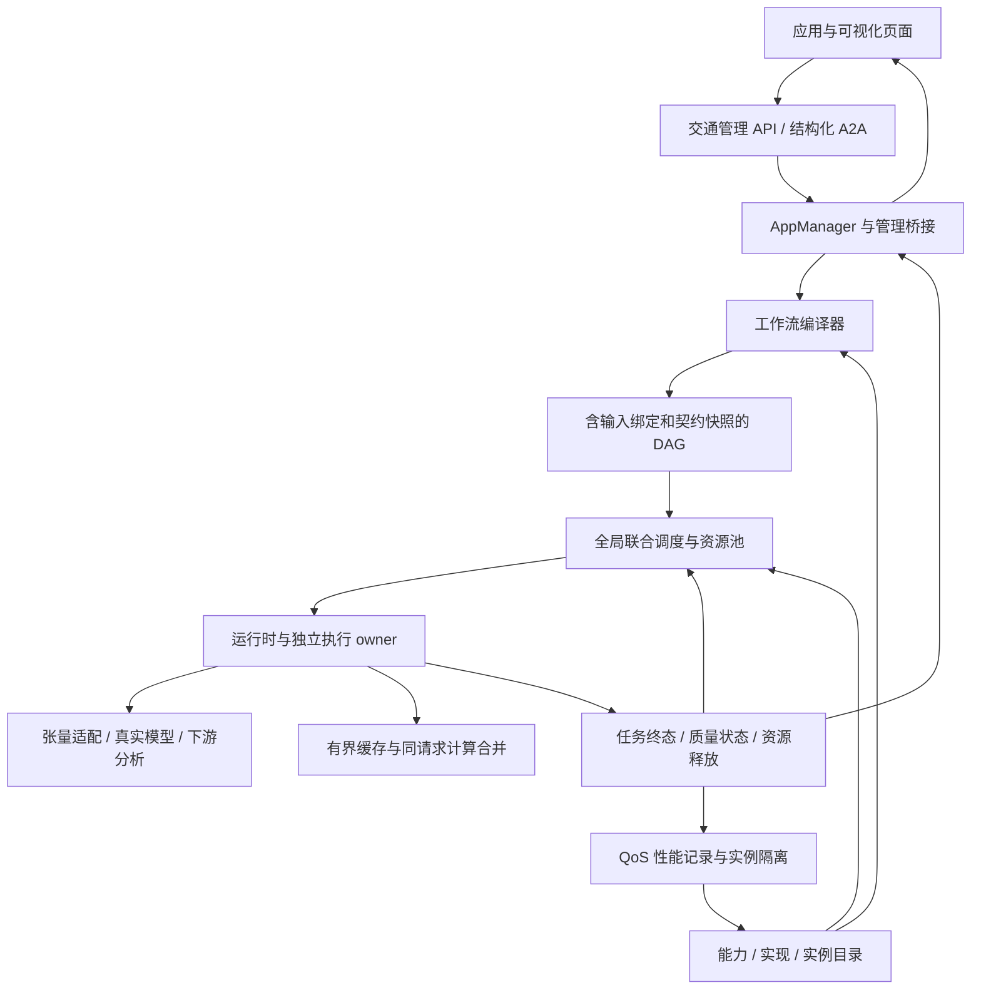

# 智能体与资源联合编排交通计算平台

平台将交通业务请求编译为能力 DAG，在同一资源池中选择就绪任务及其执行实例。运行时执行真实 B1 预测和下游校验/分析，应用管理桥接原 AppManager、智能体注册和 QoS。旧固定交通链路及原会话平台保留各自入口。

## 架构与执行



| 层次 | 核心文件 | 职责 |
| --- | --- | --- |
| 类型与目录 | `traffic_types.py`、`traffic_catalog.py` | 不可变计划、能力实现与实例描述、健康及性能记录 |
| 编译 | `traffic_composer.py` | 模板展开、DAG/端口校验、候选契约过滤、完整输入绑定和 schema 快照 |
| 调度 | `traffic_joint_scheduler.py` | 全局就绪队列、任务与实例联合选择、CPU/内存/并发原子预留和回收 |
| 执行 | `traffic_joint_runtime.py`、`traffic_model.py`、`traffic_contracts.py` | 真实推理、实际输入转换、缓存/计算合并、失败恢复、独立执行生命周期 |
| 管理 | `traffic_management_bridge.py`、`traffic_management.py` | 应用持久化、注册发现、QoS、健康变更、创建/运行/停止/查询 |
| 展示 | `traffic_platform_ui.py` | 应用、能力实例、联合编排、资源与 QoS、预测结果五个视图 |

表内交通文件分别位于 `src/service/`、`src/graph/` 或 `src/api/`。数值组件导入不加载会话 LLM；模型首次初始化时才加载 Torch 和真实制品。

## 三类业务与自定义模板

| 模板 | 执行链路 | 对外结果 |
| --- | --- | --- |
| `flow` | history.prepare → traffic.predict → validate.flow → result.aggregate | 流量预测 |
| `analysis` | prepare → predict → validate.state/validate.flow → analysis.congestion → aggregate | 状态、流量及规则分析 |
| `od_hotspots` | prepare → predict → validate.od → analysis.od_hotspots → aggregate | OD 预测与热点分析 |

B1 是联合三头网络，单次真实 forward 产生三类预测；各业务只执行自己的下游校验和分析。相同语义请求可以共享 forward。缓存准入要求完整三头输出有效，缓存条目受数量和字节限制。模型、数据、窗口、训练统计和输入契约身份纳入复用键；每个消费者仍有独立工作流、下游校验与终态记录。

编译器同时检查所有保留候选之间的上游/下游兼容性。该策略保守，某组候选被拒绝表示当前候选集合无法全部安全连接；不代表全局不存在其他可行组合。`candidate_adapter_schemas` 在计划中保存完整源/目标 schema，运行时根据实际上下游实例选择声明并执行轴转置、单位及标准化转换，输出真实转换轨迹。区域、时间、字段及模型身份不兼容时拒绝连接，不修改训练统计。

自定义模板通过 `POST /traffic/platform/templates` 注册，并由 `GET /traffic/platform/templates` 查询。模板沿用编译器的 nodes、显式 inputs 和 outputs 定义，执行能力来自已有目录；注册模板不会自动创建新的模型实现。未注册的模板和缺失输入端口被拒绝。

## 调度、恢复与资源口径

`JointScheduler` 提供 `fcfs`、`drc`、`edf`、`heft`、`joint` 五种策略，全部共享相同资源准入、依赖、取消和重试语义。HEFT 为面向在线 DAG 的适配策略；联合策略结合有效优先级、等待老化、截止期余量、关键路径与预计实例完成时间。

业务 deadline 是软时效目标，记录超期并影响选择；节点 timeout 是执行期限。运行中取消或超时只请求停止。同步线程工作和共享推理有独立 owner，确认真实 Future 终态后才 finish/release。失败重试由调度器统一管理，attempt 和 reservation_id 过滤重复或迟到回调；success + valid 才放行后继。

CPU、内存、并发账本是平台声明配额。总内存先扣模型/数据常驻和缓存预算，再用于任务增量预留。singleflight 跟随者占请求缓冲/等待配额，共享模型常驻额度不会重复计算。进程 RSS/CPU 是独立实测字段，不能将账本峰值写成操作系统硬限制或实测占用。

QoS 接收实际任务执行记录。 owned 实例触发阈值告警后进入隔离，有冷却时间并记录 `qos_actions`；后续调度避开该实例，已运行工作继续由 owner 管理。健康恢复使用显式 health API；该流程不创建 Docker 容器，也不替换原有保护骨架。

## 启动和环境变量

安装和导出见 [traffic_artifacts.md](traffic_artifacts.md)。独立服务默认端口 18763。若使用其他端口，同步配置 `TRAFFIC_SERVICE_URL`，让登记实例端点与服务一致。

| 变量 | 默认值 | 含义 |
| --- | --- | --- |
| `TRAFFIC_EXPERIMENT_ROOT` | 制品定位规则 | 包含 model/data/results 的真实实验根 |
| `TRAFFIC_SERVICE_URL` | `http://127.0.0.1:18763` | 登记实例与应用访问地址 |
| `TRAFFIC_CPU_BUDGET` | `4` | 全局 CPU 声明配额 |
| `TRAFFIC_MEMORY_BUDGET_MB` | `2048` | 总内存额度，按 MiB 使用 |
| `TRAFFIC_MAX_CONCURRENCY` | `4` | 全局并发上限 |
| `TRAFFIC_INSTANCE_COUNT` | `2` | 独立加载的模型服务实例数 |
| `TRAFFIC_POLICY` | `joint` | 调度策略 |
| `TRAFFIC_APPS_STORE_PATH` | 原 AppManager store | 可选的应用持久化路径 |

应用配置与最终状态写入 AppManager store；应用绑定的自定义模板定义随 Guidance metadata 保存并在初始化时恢复。未绑定应用的动态模板、执行 Future、预测缓存和工作流事件属于当前进程状态。重启后保留应用配置，在途执行标为 interrupted。

## API 操作

创建应用请求：

```json
{
  "name": "交通状态与流量分析",
  "request": {
    "template": "analysis",
    "target_frames": [1264, 1265, 1266, 1267, 1268, 1269, 1270, 1271],
    "deadline_seconds": 120.0,
    "priority": 1,
    "max_attempts": 2,
    "enable_reuse": true,
    "enable_contracts": true,
    "enable_recovery": true
  }
}
```

| 方法及路径 | 操作 |
| --- | --- |
| `GET /traffic/platform/ui` | 浏览器五视图页面 |
| `GET /traffic/platform/overview` | 初始化状态、应用、实例、全局资源及 QoS 行为 |
| `GET /traffic/platform/catalog` | 能力实现、实例和性能 |
| `GET/POST /traffic/platform/templates` | 查询/注册业务模板 |
| `GET/POST /traffic/platform/apps` | 列表/创建交通应用 |
| `GET /traffic/platform/apps/{app_id}` | 配置和持久化状态 |
| `POST /traffic/platform/apps/{app_id}/run` | 返回 202 和 workflow_id |
| `POST /traffic/platform/apps/{app_id}/stop` | 请求取消并由独立 owner 跟踪真实终态 |
| `POST /traffic/platform/workflows` | 直接提交或按 appid 运行 |
| `GET /traffic/platform/workflows/{workflow_id}?wait=true` | 等到真实完成并返回结果 |
| `GET /traffic/platform/resources` | 全局任务账本、事件与实测资源 |
| `GET /traffic/platform/qos` | QoS 统计 |
| `GET /traffic/platform/instances/{instance_id}` | 实例状态与原 A2A 接入信息 |
| `POST /traffic/platform/instances/{instance_id}/execute` | 将请求绑定到指定已登记实例 |
| `POST /traffic/platform/instances/{instance_id}/health` | `{"healthy": true, "reason": "人工复核通过"}` |

`POST /a2a/execute` 的结构化任务包含 `template` 时进入联合平台，并按 receiver 绑定登记实例；原无 template 的三能力调用仍使用固定交通兼容路径。管理 API 传错类型、重复帧、跨日历史不足或未知模板时返回明确错误。

联合工作流成功终态为 `completed`；A2A协议外层对应 `success`。任务的调用、质量与调度状态分别保存，不能把这两层状态字符串混用。

帧 1264..1271 对应 2024-01-27 08:00—12:00 的八个独立预测目标。每个目标都使用其实际观测历史 [t-3,t)，预测一个 30 分钟时间步。预测张量 state/flow 为 `(B,1,6,6,2)`，OD 为 `(B,1,6,6,36)`；batch8 不能解释为一次连续未来四小时预测。

## 验证及复运行

```bash
PYTHONDONTWRITEBYTECODE=1 PYTHONPATH=. python -m pytest tests/traffic -o addopts='' -p no:cacheprovider -q
PYTHONPATH=. python scripts/run_traffic_joint_experiments.py --artifact-root data/traffic_artifacts --mode all --output-root /path/to/new/results
PYTHONPATH=. python scripts/run_traffic_joint_simulation.py --profile-json /path/to/real/profile/responses.json --output-root /path/to/new/results
```

正式协议见 [traffic_experiment_protocol.md](traffic_experiment_protocol.md)。真实 B1 并发实验与离散事件模拟分别保存；模拟即使使用实测 profile 校准，其秒数仍是模拟时间。每次真实实验固定源码快照，保留配置、逐任务事件、CPU/RSS采样、预测对照和 shutdown 不变量；`--quick` 只用于冒烟。最终验收与结果来源见 [traffic_validation.md](traffic_validation.md)。
